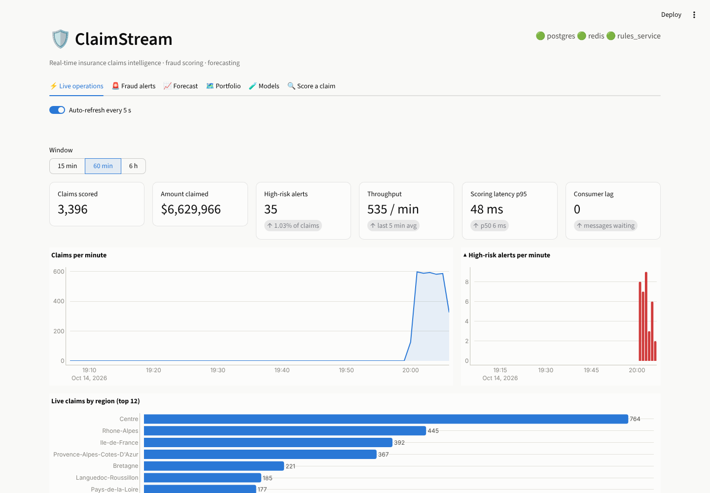
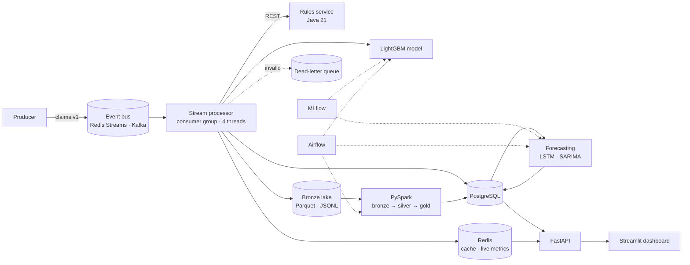
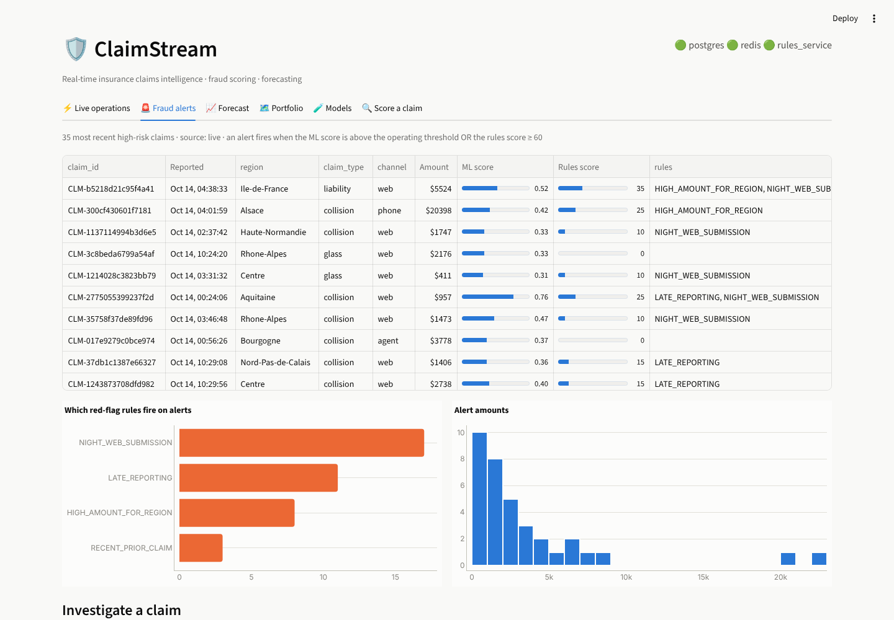
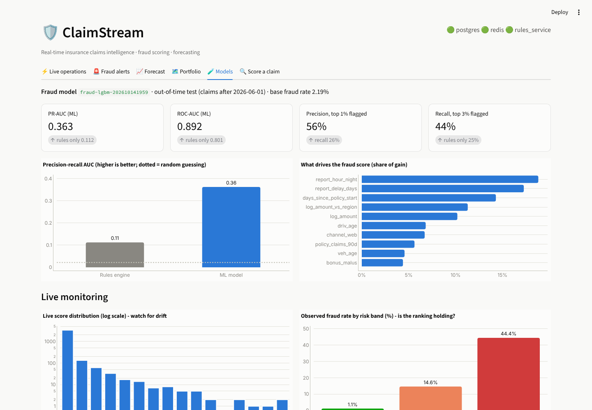
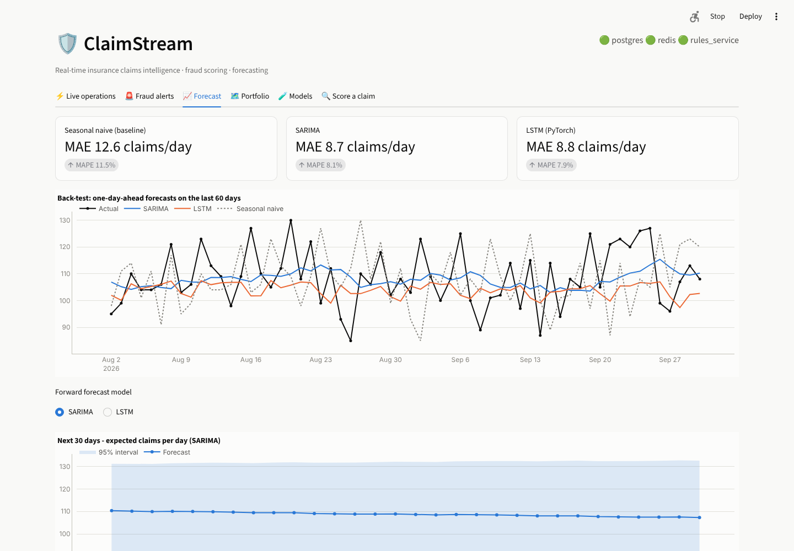
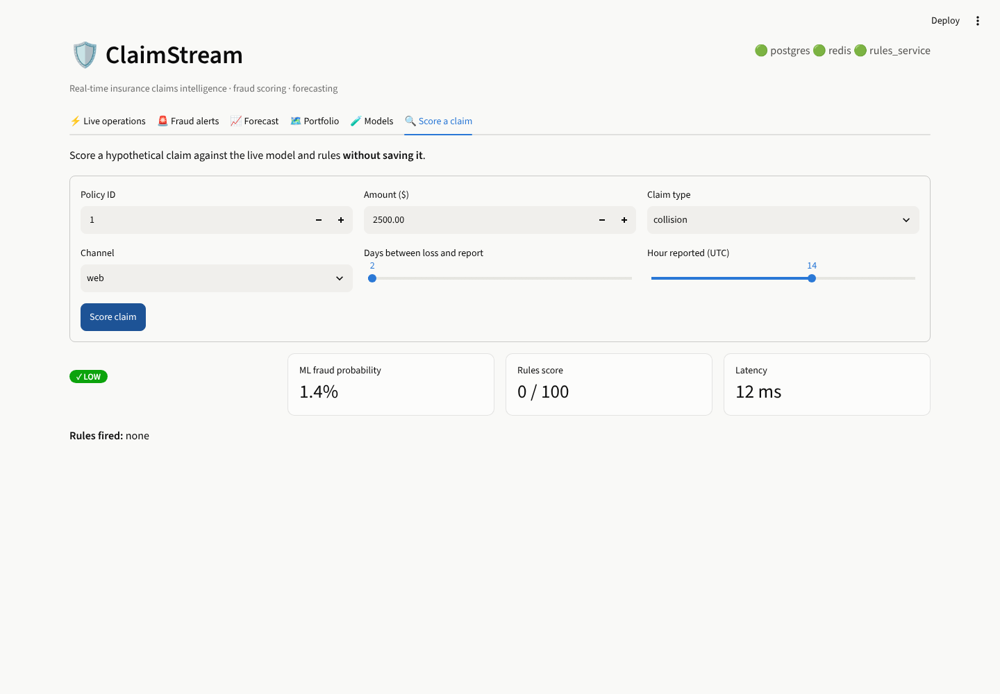

<div align="center">

# 🛡️ ClaimStream

**Real-time insurance claims intelligence: streaming ingestion, fraud scoring in milliseconds, a lakehouse, and forecasting.**

[](https://github.com/Aman23000/claimstream/actions/workflows/ci.yml)


[](https://github.com/astral-sh/ruff)
[](LICENSE)



</div>

## Contents
- [Overview](#overview) · [Architecture](#architecture) · [Results](#results) · [Dashboard](#dashboard)
- [Quick start](#quick-start) · [Project structure](#project-structure) · [Testing](#testing)
- [Design decisions](#design-decisions) · [Data](#data) · [Roadmap](#roadmap) · [Author](#author)

## Overview

The best time to catch a fraudulent insurance claim is the moment it is reported. ClaimStream treats
claims as a live event stream:

1. **Ingest:** claims arrive on an event bus (Redis Streams or Kafka) under a versioned, validated contract. Bad events go to a dead-letter queue instead of blocking the stream.
2. **Score in milliseconds:** a multithreaded processor enriches each claim from PostgreSQL and a Redis cache, then scores it two ways: a **LightGBM model** and a **Java rules microservice** with transparent, auditable red-flag rules.
3. **Land and aggregate:** raw events land in a bronze lake, and a **PySpark** job builds silver and gold tables.
4. **Forecast:** daily claims volume is forecast with an **LSTM (PyTorch)** and **SARIMA**, both checked against a naive baseline.
5. **Serve:** a **FastAPI** service powers a live **Streamlit** dashboard for operations, fraud triage, forecasting and model monitoring.

Built on **677,991 real insurance policies** and **26,444 real claim amounts**. Fraud labels are
simulated, because no public dataset has them. [Details](docs/data.md).

## Architecture



| Layer | Highlights | Tech |
|---|---|---|
| Ingestion | Versioned contract, dead-letter queue, bursty load generator | Pydantic, Redis Streams / Kafka |
| Stream processing | Consumer groups, at-least-once delivery, idempotent writes, crashed-worker recovery (`XAUTOCLAIM`) | Python threads |
| Rules engine | Auditable SIU rules, thread-pool HTTP server, zero dependencies | Java 21 |
| Resilience | Circuit breaker, validated cache-aside, quality gates | Redis, PostgreSQL |
| Fraud ML | Out-of-time validation, rules baseline, one feature definition for training and serving | LightGBM, MLflow |
| Lakehouse | Dedup, typing, daily aggregates, rolling windows | PySpark |
| Forecasting | Rolling-origin back-test, 30-day forecast with intervals | PyTorch, statsmodels |
| Serving | Connection pooling, what-if scoring, OpenAPI docs | FastAPI |
| Analytics SQL | Constraints, indexes, views with window functions | PostgreSQL 16 |
| DevOps | Multi-stage Docker, compose with Kafka (KRaft), CI, Airflow DAGs | Docker, GitHub Actions, Airflow |

More detail: [docs/architecture.md](docs/architecture.md) · [docs/api.md](docs/api.md)

## Results

All numbers come from a clean end-to-end run.

**Fraud detection.** Out-of-time test on 13,089 claims, 2.2% fraud.

| Metric | Rules engine | **ML model** |
|---|---:|---:|
| Precision-recall AUC | 0.112 | **0.363** (3.2×) |
| ROC AUC | 0.801 | **0.892** |
| Recall when flagging the top 3% of claims | 25% | **44%** |
| Precision in the top 1% flagged | — | **56%** (vs a 2.2% base rate) |

On the live stream, **39% of HIGH-risk alerts were real fraud vs 1.1% of LOW**.

**Claims-volume forecasting.** One-day-ahead forecasts, 60-day hold-out.

| Model | MAE (claims/day) | MAPE |
|---|---:|---:|
| Seasonal naive (baseline) | 12.6 | 11.5% |
| **SARIMA** | **8.7** | 8.1% |
| LSTM (2-layer, early stopping) | 8.8 | 7.9% |

Both models cut error by about 30% against the baseline. The LSTM does **not** beat SARIMA on two years of
daily data, so the simpler model wins on cost ([ADR 0003](docs/adr/0003-out-of-time-validation.md)).

**Streaming.** 2 vCPU, 4 worker threads.
- About **77 claims/s** end to end, covering validation, enrichment, ML, the rules call, 2 database writes, metrics and the lake append.
- **Scoring latency:** p50 **5 ms** with a warm cache, p95 about **50 ms**.

## Dashboard

| Fraud alert triage | Model monitoring |
|---|---|
|  |  |
| **Forecasting** | **What-if scoring** |
|  |  |

## Quick start

**Docker** (the whole stack, including Kafka):
```bash
git clone https://github.com/Aman23000/claimstream.git && cd claimstream
make docker-up            # → http://localhost:8501 (dashboard) · http://localhost:8000/docs (API)
```

**Local** (Python 3.11+, Java 17+, PostgreSQL 16, Redis 7):
```bash
make install && make rules
java -jar rules-service/rules-service.jar &      # the training job benchmarks against the rules
make pipeline             # download → load DB → fraud model → Spark → forecast   (~2 min)
make up                   # rules · processor · API · producer · dashboard
```

**macOS, one command:** `bash scripts/setup_mac.sh --start`

Configuration is entirely through environment variables. See [`.env.example`](.env.example).

## Project structure
```
claimstream/
├── common/      events.py (contract) · bus.py (Redis Streams / Kafka)
├── ingest/      download · simulator · bootstrap (Postgres COPY + Parquet lake)
├── stream/      producer · processor · scoring (features, model, rules, circuit breaker)
├── batch/       spark_daily.py (bronze → silver → gold)
├── ml/          features.py (shared train/serve) · train_fraud.py · train_forecast.py
└── api/         main.py (FastAPI)
rules-service/   Java rules engine · tests · multi-stage Dockerfile
dashboard/       Streamlit app
sql/             schema · reporting views
airflow/dags/    daily batch + forecast · weekly fraud retrain
docs/            architecture · API · data · ADRs · screenshots
tests/           unit + integration (pytest)
```

## Testing
```bash
make test        # unit tests: contract, train/serve feature parity, simulator invariants, circuit breaker
make test-all    # + integration: Redis Streams round-trip/ack/lag, API endpoints (needs the stack running)
make rules       # Java rules-engine tests
```
CI runs lint, unit tests and the Java build, then runs the **full data → model → Spark → forecast pipeline**
against real Postgres and Redis service containers before the integration tests.

## Design decisions
- [ADR 0001](docs/adr/0001-event-bus-abstraction.md): one event-bus interface over Redis Streams and Kafka
- [ADR 0002](docs/adr/0002-rules-plus-ml.md): a transparent rules engine alongside the ML model
- [ADR 0003](docs/adr/0003-out-of-time-validation.md): out-of-time validation instead of random splits

## Data
Real policies and claim amounts; simulated timing and fraud labels. The fraud metrics validate the
method, not real-world fraud rates. Full breakdown in [docs/data.md](docs/data.md).

## Roadmap
- [ ] Batch enrichment queries and a Redis feature store, to raise throughput beyond the per-claim DB round-trips
- [ ] Drift monitoring (PSI) with automatic retraining when it fires
- [ ] SHAP explanations on each alert for investigators
- [ ] Kubernetes manifests with processor autoscaling on consumer lag
- [ ] Authentication on the API (OAuth2)

## Author
**Aman Jain**: Data / ML engineer · M.S. Computer Science, Boston University
[LinkedIn](https://www.linkedin.com/in/jamanbuilds) · [GitHub](https://github.com/Aman23000) · jamanbuilds@gmail.com

Licensed under the [MIT License](LICENSE).
