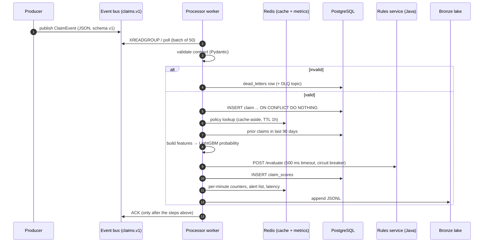

# Architecture

## Data flow



## Components

| Component | Responsibility | Scaling story |
|---|---|---|
| `stream/producer.py` | Simulates claims being reported now (bursty arrivals, ~0.5% malformed) | n/a (test load generator) |
| `common/bus.py` | One interface over Redis Streams and Kafka | Kafka partitions keyed by `policy_id` |
| `stream/processor.py` | Consumer-group workers: validate → persist → score → metrics → ack | More threads, more processes, more partitions |
| `stream/scoring.py` | Feature assembly, model inference, rules call, risk banding | Stateless apart from caches |
| `rules-service/` | Deterministic, auditable red-flag rules over HTTP | Stateless; run N replicas behind a load balancer |
| `batch/spark_daily.py` | Bronze → silver (dedup, typing) → gold (daily aggregates, rolling windows) | Same code on Databricks / EMR |
| `ml/train_fraud.py` | Out-of-time training, rules benchmark, threshold selection, MLflow logging | Weekly (Airflow) |
| `ml/train_forecast.py` | Seasonal-naive vs SARIMA vs LSTM, rolling-origin back-test, 30-day forecast | Daily (Airflow) |
| `api/main.py` | REST over Postgres (pooled) and Redis | Stateless; horizontal |
| `dashboard/app.py` | Streamlit UI; reads only through the API | Stateless |

## Delivery guarantees

- **At-least-once.** A message is acknowledged only after its claim and score are committed. If a worker
  dies, the message stays pending and `XAUTOCLAIM` reassigns it after 30 seconds (Kafka: uncommitted offsets
  are re-read).
- **Idempotent processing.** `claims.claim_id` is the primary key and inserts use `ON CONFLICT DO NOTHING`.
  A redelivered message is detected (`rowcount == 0`) and acknowledged without being scored twice.
- **Poison messages.** Contract violations and business-rule failures (for example, an unknown policy) go to
  `dead_letters` and are acknowledged, so they can't block the stream. Unexpected exceptions are *not*
  acknowledged, so they are retried.

## Failure modes

| Failure | Behaviour |
|---|---|
| Rules service down or slow | 500 ms timeout. After 5 consecutive errors the circuit opens for 30 seconds; claims are scored by the model alone and tagged `RULES_UNAVAILABLE` |
| Corrupt cache entry | Validated on read; deleted and refetched from Postgres |
| Malformed event | Dead-letter table plus DLQ topic, with the exact validation error |
| Duplicate delivery | Ignored through the primary key |
| Worker crash | Pending messages reclaimed by another worker |

## Risk banding

```
HIGH    model_score ≥ t      OR  rule_score ≥ 60
MEDIUM  model_score ≥ t / 3  OR  rule_score ≥ 30
LOW     otherwise
```
`t` is chosen on the out-of-time test set as the threshold with the highest recall while keeping
precision at or above 50%, a proxy for investigator capacity.

## Storage

PostgreSQL holds the operational state: `policies`, `claims`, `claim_scores`, `dead_letters`,
`daily_claims`, `forecasts` and `model_metrics`, plus reporting views that use window functions
(`v_fraud_alerts`, `v_hourly_kpis`, `v_region_summary`). Redis holds hot state only: caches, per-minute
counters, the alert list and the latency ring buffer. Everything in Redis can be rebuilt.
